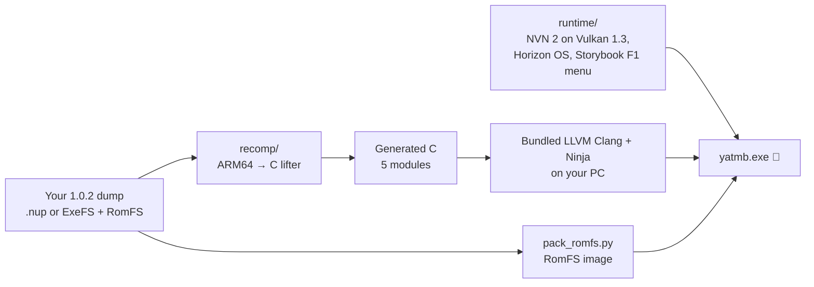

<div align="center">


# 📖 SteelTemple YATMB

### Yoshi and the Mysterious Book, running natively on Windows PC

*A static recompilation of the Nintendo Switch 2 game, not an emulator.*

[](#-requirements)
[](#-under-the-hood)
[](#-quick-start)
[](https://github.com/STS78721/YATMB/releases/tag/0.1.0)
[](#-credits--licence)

**[Quick start](#-quick-start)** · **[Features](#-highlights)** · **[Status](#-status)** · **[How it works](#-under-the-hood)** · **[Changelog](CHANGELOG.md)** · **[Credits](#-credits--licence)**

</div>

---

> [!WARNING]
> **Early Release (`0.1.0`):** *Yoshi and the Mysterious Book* is working and playable right now, but this is an **early release** — you may still encounter rendering issues, visual glitches, shader compilation stutters, or performance drops in later chapters and across different GPU/CPU configurations. Updates will continue to polish visuals, stability, and performance.

> [!IMPORTANT]
> **No game files are included.** You need your own legally dumped copy of **Yoshi and the Mysterious Book (1.0.2)** (either a `.nup` container or `ExeFS` and `RomFS` dump folders). This repository contains only the recompiler, runtime, launcher, and setup tools.

> [!NOTE]
> **Clean Zero-Config Defaults:** SteelTemple YATMB launches on a safe, hardware-agnostic baseline (`1920x1080` windowed, Original internal resolution, Storybook Meadow `F1` menu, `16x` anisotropic filtering, AMD FSR, Frame Generation Off, `60 FPS` limit) with no personal `.ini` settings bundled. Adjust resolution up to native `4K (2160p)`, upscaling, and controls anytime in **YATMBLauncher** or in-game (`F1`).

## ✨ Highlights

<table>
<tr>
<td width="50%" valign="top">

### 🚀 Native Windows PC binary, not emulation
Every ARM64 instruction across `main`, `subsdk0`, `subsdk1`, `subsdk2`, and `sdk` is translated **ahead of time** into C and compiled natively on your PC into `yatmb.exe`. No CPU interpreter runs while you play.

### 🖼️ Native 720p–4K UE5 resolution & crisp UI
Switch cleanly between **Original**, **720p**, **900p**, **1080p**, **1440p**, and **native 4K (2160p)** internal resolutions with linear UI DPI scaling, AMD FSR 1.0, Bilinear scaling, and colour presets.

### 🎨 Vulkan 1.3 renderer & SM86 shader pipeline
Translates Switch 2 NVN 2 commands and Ampere (`SM86`) shaders to Vulkan 1.3 with GPU compute mirror diff write-back, per-level GPU texture ownership, and host H.264 movie decoding via Windows Media Foundation.

</td>
<td width="50%" valign="top">

### 📖 Storybook Meadow F1 menu
Press **F1** or **Esc** (or **Back + Y** on a controller) for a native settings overlay in the **Storybook Meadow** theme (plus Dark and Light themes) with live telemetry and config saving to `yatmb.ini`.

### 🖥️ Setup Wizard & YATMBLauncher (.nup & direct dumps)
Install cleanly with **`SteelTemple-YATMB-0.1.0-Full-Setup-Wizard.exe`** or the portable archive: bundled LLVM-MinGW, Ninja, and Python verify your **1.0.2** `.nup` container or `ExeFS`/`RomFS` folders and build `yatmb.exe` locally with no external tools required.

### 🕹️ Controllers, mods & local save backups
Supports Xbox, DualSense, Nintendo Switch / Switch 2 Pro controllers, and keyboard out of the box. Includes quick folder access and timestamped save snapshots inside **YATMBLauncher**.

</td>
</tr>
</table>

## 📊 Status (`0.1.0` Early Release)

| Area | State |
|---|---|
| Boot, title/opening H.264 movies, menus | ✅ Working |
| Book Hub & early 3D gameplay stages | ✅ Playable (60 fps target) |
| Native internal resolution (`original` – `2160p` 4K) | ✅ Working |
| Audio, saves & controller input | ✅ Working |
| Later chapters, edge-case visuals & performance across GPUs | ⚠️ Early release — rendering and performance issues may still occur |
| Online play | ❌ Not supported, by design |

## 🚀 Quick start

**1. Install SteelTemple YATMB**

Download **`0.1.0`** from the **[Releases page](https://github.com/STS78721/YATMB/releases/tag/0.1.0)**:
- Run **`SteelTemple-YATMB-0.1.0-Full-Setup-Wizard.exe`** (no administrator rights required), or extract **`SteelTemple-YATMB-0.1.0-Portable-StandAlone.zip`**.

**2. Set up from your Yoshi and the Mysterious Book 1.0.2 dump**

Open **YATMBLauncher** → **SETUP FROM DUMP**, then choose one of:
- a **`.nup`** container (combined, or split base + `1.0.2` update in the same folder),
- a dump / NUP-extracted folder (flat `ExeFS` + `RomFS`, or `updates\<ver>\exefs`), or
- your **`ExeFS`** and **`RomFS`** folders directly.

Click **VERIFY & BUILD YATMB.EXE**. Setup verifies all 7 `1.0.2` ExeFS SHA-256 hashes, packs RomFS, lifts all 5 ARM64 modules to C, compiles `yatmb.exe` natively, and runs a short muted shader pre-warm pass.

**3. Play:** click **PLAY YOSHI PC** (or run `yatmb.exe`).

<details>
<summary>Building from source (developers)</summary>

```bat
python tools\check_content.py
.venv\Scripts\python.exe recomp\gen.py --exefs "<dump>\exefs" --out generated\yoshi102 --patches recomp\patches-yoshi102.txt --modules main,subsdk0,subsdk1,subsdk2,sdk
.venv\Scripts\python.exe tools\pack_romfs.py --dir "<dump>\romfs" --out romfs_packed
.venv\Scripts\python.exe tools\build_game.py --version yoshi102 --expected tools\data\expected-yoshi102.json --gen generated\yoshi102 --exefs "<dump>\exefs" --romfs romfs_packed
.venv\Scripts\python.exe tools\build_yatmb_release.py
```

</details>

## 🖥️ Requirements

| | Minimum | Recommended |
|---|---|---|
| OS | Windows 10 64-bit | Windows 11 |
| CPU | x86-64 with AVX2 | 8 cores or more |
| GPU | Vulkan 1.3, 6 GB VRAM | NVIDIA RTX 30/40/50 or AMD RX 6000/7000, 8+ GB VRAM |
| RAM | 16 GB | 32 GB |
| Disk | ~25 GB free during setup | NVMe SSD |

## ⚙️ Settings

Press **F1** / **Esc** in game or configure before launch inside **YATMBLauncher**. Settings save cleanly to `yatmb.ini` next to `yatmb.exe`, and any option can also be overridden with `YATMB_` / `NS2_` environment variables.

## 🔧 Under the hood



- **CPU:** *Yoshi and the Mysterious Book*'s five ARM64 modules (`main`, `subsdk0`, `subsdk1`, `subsdk2`, `sdk`) are statically lifted to C ([`recomp/`](recomp/)); [`runtime/`](runtime/) supplies the Horizon OS kernel, load-order symbol resolution, H.264 decoding, memory management, audio, input, and the Storybook Meadow settings UI.
- **GPU:** Switch 2 NVN 2 commands translate onto **Vulkan 1.3** with Graphics Pipeline Libraries, Ampere (`SM86`) shader lowering, 128-bit coalesced GPU compute mirror diff write-back, AMD FSR 1.0, and frame pacing.
- **Release Versioning:** [`VERSION`](VERSION) / [`launcher/yatmb_version.txt`](launcher/yatmb_version.txt) drive the version label across the Setup Wizard, `YATMBLauncher`, Windows Installed Apps, and `yatmb.exe`, alongside [`CHANGELOG.md`](CHANGELOG.md).

## 🙏 Credits & licence

Built with **Universal NS2 to PC**, **Eglantine** (Ampere SM86 shader lowering), **Ryujinx**, **SDL3**, **Dear ImGui**, **Vulkan Memory Allocator (VMA)**, **libopus**, **libvpx**, **dav1d**, **zstd**, and **FidelityFX FSR**.

Licensed under the **GNU GPL v3 or later** (see [`LICENSE`](LICENSE)); permissive and third-party notices are preserved in [`THIRD_PARTY_NOTICES.md`](THIRD_PARTY_NOTICES.md).

---

<div align="center">

<sub>Yoshi and the Mysterious Book is a trademark of Nintendo. This is an unofficial non-commercial fan research project, not affiliated with or endorsed by Nintendo. Please support the official release.</sub>

</div>
